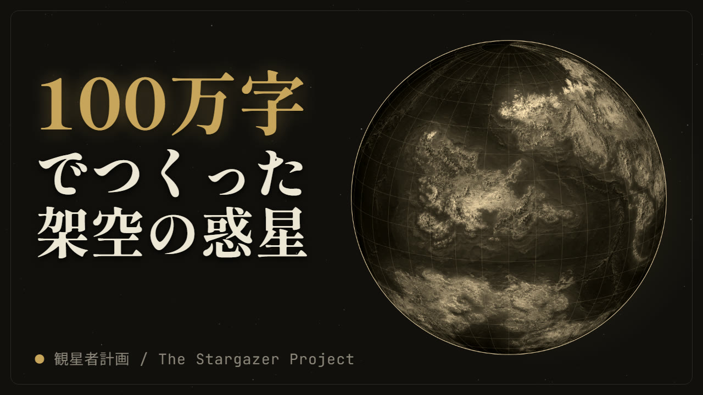

O wings that burn eternally, carry me beyond the dust and burdens of the mortal world.

# The Stargazer Project

**観星者計画 · 观星者计划**

The Stargazer Project is a worldbuilding project centered on **The Starwood (星間林地)**, a fictional super-habitable planet in the Kepler-452b system. It lies about 1,400 light-years from Earth in the direction of Cygnus and orbits a G-type main-sequence star.

The heart of the project is the full manuscript, which runs to about one million characters and covers nine continents, thirty-three nations and political entities, a history, a currency system, international organizations, technology, beliefs, and the Starwood Calendar. In the story, the present year is 5501.

The long-term goal is an open, high-quality worldbuilding foundation. Any company, organization, or individual should be able to use it for free, including for commercial work and fan creations, with attribution as the only requirement.

## Video

▶ **[Watch on YouTube](https://youtu.be/gJHNopIlRWM)**: a 12-minute introduction narrated in Japanese, with Japanese subtitles. It covers the problem with worldbuilding in today's big IPs, the four core features of the project (inclusiveness, comprehensiveness, openness, and universality), and how the website is built.

## Presentation

- [`presentation/観星者計画_完全版プレゼンテーション.pptx`](presentation/観星者計画_完全版プレゼンテーション.pptx): full presentation (Japanese)
- [`presentation/观星者计划_完整演示版.pptx`](presentation/观星者计划_完整演示版.pptx): full presentation (Chinese)

## The website

- **Trilingual.** Chinese, English, and Japanese. One `app:languagechange` event switches the whole page at once, and a shared [glossary](术语表_Glossary_v1.md) keeps the terms consistent across all three languages.
- **Infinite horizontal map.** A scrolling map in the style of a grand-strategy game, built from custom map tiles, with eight zoom levels.
- **Twelve topics in three tiers.** The sidebar covers the planetary environment, political systems, currency, the historical timeline, megacorporations, international organizations, the star map, the technology tree, beliefs and philosophy, racial traits, monuments, and an immigration life guide. These are grouped as *politics & history*, *economy & beliefs*, and *individual stories*.
- **Live world statistics.** Population, power generation, Gini coefficient, corruption perception, and more. Each value adds a small random fluctuation to a base value, so the world feels alive.
- **Lightweight.** Plain HTML, CSS, and JavaScript. Leaflet 1.9.4 is the only external library.

## Status

This is a graduation project at HAL (class of 2028) by YANYONG. Only the frontend exists so far; the backend and further content are planned next.

The full manuscript is not published in full yet. The website presents a curated selection, and more will be released step by step.

All rights are currently reserved. The pages opt out of search indexing and AI training (`noindex, nofollow, noai, noimageai`). A formal open license is planned for the future.
